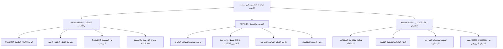
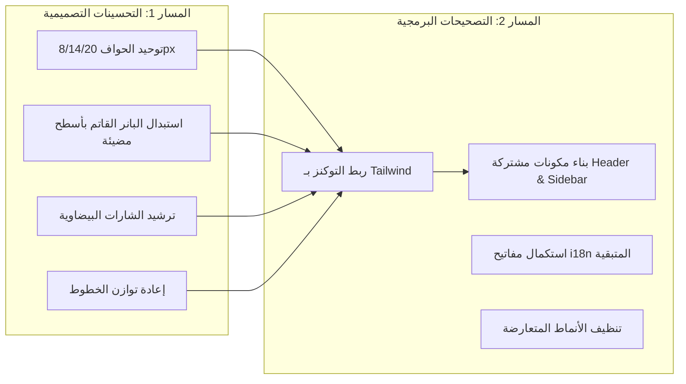

# تقرير التدقيق الشامل للهوية البصرية وجودة الكود البرمجي
## Al-Ameen Platform: AI-Generated Design Identity & Codebase Audit Report

> [!IMPORTANT]
> **إقرار بنطاق العمل والتحكّم بالقرارات (Scope Control & Zero-Execution Guarantee)**:  
> هذا التقرير هو وثيقة تدقيق استراتيجية وتحليلية شاملة تم إعدادها بناءً على طلبك.  
> **لم يتم تطبيق أي تغييرات برمجية أو تصميمية على ملفات النظام الأساسية، والتقرير لا يمثل إذناً بالبدء بالتنفيذ حتى يتم اعتماد القرارات المقترحة بشكل صريح.**

---

## فهرس التقرير
1. [المقدمة والسياق الاستراتيجي للمنتج](#1-المقدمة-والسياق-الاستراتيجي-للمنتج)
2. [القسم A: تدقيق الهوية البصرية (Visual Identity Audit)](#2-القسم-a-تدقيق-الهوية-البصرية-visual-identity-audit)
3. [القسم B: تدقيق جودة الكود والتكرار (Code Quality & Repetition Audit)](#3-القسم-b-تدقيق-جودة-الكود-والتكرار-code-quality--repetition-audit)
4. [القسم C: الحفاظ، التهذيب، أم إعادة التصميم (Preserve, Refine, or Redesign)](#4-القسم-c-الحفاظ-التهذيب-أم-إعادة-التصميم-preserve-refine-or-redesign)
5. [القسم D: استكشاف بدائل معمارية مميزة (Distinctive Design Alternatives)](#5-القسم-d-استكشاف-بدائل-معمارية-مميزة-distinctive-design-alternatives)
6. [القسم E: نظام الهوية المرئي الموحد (Visual Identity & Token System)](#6-القسم-e-نظام-الهوية-المرئي-الموحد-visual-identity--token-system)
7. [القسم F: الفصل بين مهام التصميم ومهام التنفيذ البرمجي](#7-القسم-f-الفصل-بين-مهام-التصميم-ومهام-التنفيذ-البرمجي)
8. [القسم G: مصفوفة القرارات للاعتماد والموافقة (Approval & Scope Control)](#8-القسم-g-مصفوفة-القرارات-للاعتماد-والموافقة-approval--scope-control)

---

## 1. المقدمة والسياق الاستراتيجي للمنتج
منصة **الأمين** هي منصة تدريب وتأهيل عيادي وتعليمي متخصصة في مجالات:
- علوم النطق والتخاطب (Speech & Language Pathology)
- التدخل المبكر وتأخر النمو اللغوي للأطفال
- تعديل السلوك وصعوبات التعلم

### طبيعة الجمهور المستهدف:
1. **أولياء الأمور**: يحتاجون إلى تجربة استخدام توحي بالأمان العاطفي، والوضوح التام، والخلو من التعقيد والتكلف البصري.
2. **الأخصائيون والمدربون**: يحتاجون إلى واجهات تتسم بالرصانة الأكاديمية والاعتمادية والجدية العيادية (Clinical Authority).

### مشكلة توليد التصميم بالذكاء الاصطناعي (The AI Design Trap):
الأدوات التوليدية تميل بطبيعتها إلى إنتاج "قوالب مسبقة الصنع" (UI Tropes) تتسم بـ:
- حشر كل عنصر داخل بطاقة بيضاء بإطار وظل رمادي خفيف.
- المبالغة في وضع الشارات البيضاوية (Pills) في كل سطر.
- استخدام درجات تدرج لوني داكنة عشوائية للفت الانتباه بدون هدف وظيفي.
- استخدام خطوط دائرية كرتونية حتى في المواضع التي تتطلب اعتماداً طبياً وشهادات رسمية.

---

## 2. القسم A: تدقيق الهوية البصرية (Visual Identity Audit)

تم تدقيق شاشات المنصة الـ 14 بدقة، وصُنّفت العناصر المرصودة وفق المقياس الخماسي المعتمد:

### مقياس التصنيف:
- **(1)** نمط تصميمي مقصود ومفيد (Useful and intentional pattern)
- **(2)** قاعدة اتساق لازمة ومفيدة (Necessary consistency rule)
- **(3)** نمط AI عام يستوجب التحسين (Generic AI-generated pattern worth improving)
- **(4)** عدم اتساق أو عيب تنفيذي (Inconsistency or visual defect)
- **(5)** حالة غير مؤكدة تتطلب قرار المستخدم (Uncertain case requiring user decision)

| # | العنصر المرصود | التحليل النقدي والدلالة الوظيفية | التصنيف |
|---|---|---|:---:|
| **A1** | **تشتت الحواف الدائرية (Radius Fragmentation)** | وجود أبعاد عشوائية لأنصاف الأقطار: `131px` في صور الهيرو، و `24px` للحاويات، و `20px` للبطاقات، و `16px` لبطاقات الدورات، و `10px` للأزرار، و `rounded-full` للشارات. هذا التشتت يفقد المنتج الانضباط الهندسي. | **(3)** |
| **A2** | **متلازمة البطاقات المتداخلة (Russian-Doll Card Syndrome)** | الإفراط في وضع بطاقة بيضاء داخل بطاقة رمادية داخل بطاقة زرقاء، وكل منها محاط بإطار صلب `border-[#DEE8F7]`. ينتج عن ذلك إرهاق بصري وانسداد في الفضاء السلبي. | **(3)** |
| **A3** | **البانر الكحلي القاتم (Dark Gradient Banner Trope)** | خلفية داكنة جداً `linear-gradient(158deg, #060F29 0%, #0E214A 50%, #1A3B66 83%)` في لوحة التحكم وبطاقة الشهادات. هذا النمط مستهلك في قوالب لوحات التحكم البرمجية ولا يتناسب مع المنصات التعليمية الطبية الداعمة للأطفال. | **(3)** |
| **A4** | **إغراق الواجهة بالأقراص والشارات (Pill Overuse)** | استخدام الشارات البيضاوية بكثافة تفوق الحاجة (مدة الدرس، نوع الحساب، رقم القيد، حالة التوثيق، مستوى المهارة). عندما يصبح كل سطر شارة، تفقد الشارات قدرتها على لفت النظر لما هو عاجل ومهم. | **(3)** |
| **A5** | **هيمنة خط Baloo Bhaijaan 2 على السياقات الرصينة** | الخط ممتاز وجذاب في العناوين التسويقية والصفحة الرئيسية، لكن استخدامه في الشهادات، وجداول الدرجات، والمصادقات الأكاديمية يعطي طابعاً كرتونياً غير موثوق. | **(3)** |
| **A6** | **شريط التذكير الجانبي الجامد (Static Bookmark Widget)** | كارت ثابت بنص غير متغير (`خطوة صغيرة، أثر مستمر`) مكرر في الشريط الجانبي لجميع الصفحات الداخلية، يستهلك مساحة عمودية هامة بلا تفاعل أو نفع حقيقي للطالب. | **(3)** |
| **A7** | **تكوين شبكة صور الهيرو الرباعية (2x2 Quadrant)** | تكوين مبتكر يجمع أشكالاً دائرية ومستطيلة غير متماثلة مع أوراق نباتية خفيفة. يعبر عن الطفولة والأمل، لكن أوراق الشجر ونسب التقويس تحتاج إلى تهذيب بسيط لزيادة الفخامة. | **(5)** |
| **A8** | **شريط التنقل الجانبي الأيمن المخصص لـ RTL** | تثبيت شريط التنقل على اليمين بعرض `248px` مع خلفية بيضاء وأيقونات واضحة يلائم بيئة العمل المكتبية العربية تماماً ويوفر وصولاً سريعاً لكل الأقسام. | **(2)** |
| **A9** | **ألوان الهوية الزرقاء الملكية والكحلية (#012383 و #0B2A8F)** | ثنائية الأزرق الكحلي الداكن والأزرق الملكي تمثل حجر الأساس البصري للأمان والأكاديمية، وهي أصيلة للمنتج وتمنحه وقاراً وثقلاً واضحاً. | **(1)** |
| **A10** | **اختلاف محاذاة عناصر الهيدر العلوي بين الشاشات** | ظهور حقل البحث على اليسار في بعض الشاشات وعلى اليمين في شاشات أخرى قبل توحيدها، مما يسبب قفزات بصرية مزعجة للمستخدم أثناء التنقل. | **(4)** |

---

## 3. القسم B: تدقيق جودة الكود والتكرار (Code Quality & Repetition Audit)

### 1. القيم الاعتباطية المباشرة (Hardcoded Values vs. Tokens)
- على الرغم من وجود ملف [tokens.css](file:///C:/Users/pc/.gemini/antigravity-ide/scratch/figma-html-app/src/css/tokens.css)، إلا أن الكود في صفحات HTML الـ 14 يعتمد بنسبة 95% على قيم Tailwind اعتباطية صلبة:
  - `bg-[#012383]` مكررة أكثر من 60 مرة.
  - `border-[#DEE8F7]` مكررة أكثر من 85 مرة.
  - `bg-[#EAF1FB]` مكررة أكثر من 50 مرة.
  - قياسات مباشرة مثل `w-[330px]`, `h-[42px]`, `rounded-[16px]`, `rounded-[24px]`.
- **الخطورة التقنية**: أي تعديل مستقبلي في درجة لون الإطار أو الخط يتطلب تعديل مئات الأسطر في ملفات متعددة مع احتمالية عالية للخطأ البشري.

### 2. التكرار الهيكلي للمكونات الثابتة (Code Duplication)
- كود القائمة الجانبية (Aside) المكون من أكثر من 100 سطر مكرر حرفياً في 8 صفحات مستقلة.
- كود الهيدر العلوي (Account Bar) المكون من 70 سطراً مكرر حرفياً في 8 صفحات.
- كود الفوتر السفلي (Workspace Footer) مكرر بنفس الأسلوب.

### 3. تضارب فئات التحويم مع الحالات النشطة (Specificity Collision)
- الجمع بين فئات `text-[#475569]` و `hover:bg-[#EAF1FB]` في العناصر التي يُضاف لها لاحقاً فئات `bg-[#012383]` و `text-white` عبر JavaScript، كان يتسبب في شحوب ألوان التبويبات النشطة عند مرور الفأرة فوقها بسبب تساوي أسبقية فئات Tailwind.

### 4. بنية التدويل (i18n Engine Completeness)
- محرك [i18n.js](file:///C:/Users/pc/.gemini/antigravity-ide/scratch/figma-html-app/src/js/i18n.js) مبني بأسلوب حديث وخفيف عبر سمات `data-i18n`. لكن هناك نصوص عربية ثابتة ما تزال مكتوبة بشكل مباشر في بعض الصفحات (مثل `reviews.html` و `contact.html`) مما يمنع ترجمتها للإنجليزية عند تحويل اللغة.

---

## 4. القسم C: الحفاظ، التهذيب، أم إعادة التصميم (Preserve, Refine, or Redesign)



### قرارات PRESERVE (الحفاظ)
1. **ثنائية الألوان الكحلية والملكية (`#012383` / `#0B2A8F`)**: تمنح المنصة شخصية موثوقة وجادة تليق بمركز طبي وتدريبي متخصص.
2. **التصميم العربي الأصيل لشريط التنقل (Sidebar RTL)**: يحقق كفاءة استخدام عالية ومحاذاة طبيعية لعين القارئ العربي.
3. **تكوين شبكة صور الهيرو (2x2 Quadrant)**: عنصر بصري فريد يكسر نمطية صفحات الهبوط التقليدية ويبرز تفاعل الطفل والأخصائي.

---

### قرارات REFINE (التهذيب والضبط)
1. **توحيد مقياس الحواف (Radius Scale)**:
   - *المشكلة*: وجود أكثر من 7 قياسات مختلفة للحواف بدون تسلسل منطقي.
   - *الأهمية*: التناسق الهندسي يمنح الواجهة نضجاً ورقيّاً فورياً.
   - *المبدأ*: اعتماد مقياس ثلاثي واضح (8px للعناصر الصغيرة، 14px للبطاقات، 20px للحاويات الكبرى).
   - *الموافقة المطلوبة*: نعم.
2. **ضبط الخطوط حسب السياق (Typography Hierarchy)**:
   - *المشكلة*: استخدام خط العناوين الكرتوني في وثائق الدرجات والشهادات.
   - *الأهمية*: استعادة الرصانة الأكاديمية للشهادة حتى يشعر المتدرب بقيمتها المهنية.
   - *المبدأ*: استخدام `Cairo Bold` للشهادات وجداول الدرجات والتقارير، وإبقاء `Baloo Bhaijaan 2` للعناوين التسويقية والترحيبية فقط.
   - *الموافقة المطلوبة*: نعم.
3. **ترقية كارت التذكير الجانبي (Sidebar Reminder)**:
   - *المشكلة*: بطاقة ثابتة تكرر نفس العبارة دون أي وظيفة ديناميكية.
   - *المبدأ*: ربطها بنسبة إنجاز الدورة الحالية مع زر "استكمل الآن" أو إمكانية طيها لتوفير المساحة.
   - *الموافقة المطلوبة*: نعم.

---

### قرارات REDESIGN (إعادة التصميم)
1. **تفكيك البطاقات المتداخلة (Russian-Doll Cards)**:
   - *المشكلة*: سجن كل فقرة وصورة وعنصر تحكم داخل إطار رمادي وظل، مما أدى لانسداد الفضاء البصري.
   - *المبدأ*: استبدال الإطارات السميكة بالفضاء السلبي الذكي (White Space) والتباين اللطيف في ألوان الخلفيات.
   - *الموافقة المطلوبة*: نعم (قرار هوياتي بارز).
2. **استبدال البانرات الداكنة بأسطح عيادية مضيئة (Luminous Surfaces)**:
   - *المشكلة*: بانر المهام في لوحة الطالب مظلم وكئيب يشبه قوالب الأمن السيبراني.
   - *المبدأ*: استخدام تدرجات زرقاء سماوية ناعمة ومشرقة توحي بالأمل والدعم النفسي للطفل وولي الأمر.
   - *الموافقة المطلوبة*: نعم.

---

## 5. القسم D: استكشاف بدائل معمارية مميزة (Distinctive Design Alternatives)

### البديل 1: تكوين بطاقة متابعة الدرس في لوحة الطالب (Resume Learning)
- **النمط الحالي (AI Template)**: بطاقة عملاقة بها صورة فيديو بعرض كامل بارتفاع 320px، يعلوها خط تقدم منفصل، وتحتها أزرار وتفاصيل مكدسة تشغل نصف الشاشة.
- **البديل المقترح (Studio Hero Card)**:
  - تقسيم أفقي متوازن (Split-Card): النصف الأيمن مشغل فيديو مدمج ومجهز لنقطة التوقف (Resume at 08:00) بضغطة واحدة، والنصف الأيسر يعرض "الواجب العملي المطلوب تسليمه لهذا الدرس" ورابط تحميل ورقة النشاط مباشرة.
  - *الميزات*: تقليل الارتفاع للنصف، ربط المشاهدة بالواجب العملي فوراً، رفع معدل تسليم المهام.

### البديل 2: معمارية بطاقات الكتالوج والدورات (Course Cards)
- **النمط الحالي**: صورة، عنوان، مؤشر تقدم، زر تفاصيل الدورة (قالب LMS مجاني تقليدي).
- **البديل المقترح (Clinical Track Card)**:
  - إعطاء بطاقة الدورة هوية "المسار التأهيلي المتكامل":
    - شريط علوي بلون دلالي تخصصي (أخضر زمردي للتخاطب، أزرق نيلي لمخارج الحروف، موف هادئ للتدخل المبكر).
    - عرض صور مصغرة للأخصائيين المشرفين على المسار مع اعتمادهم الطبي.
    - مؤشر حالة نبضي يوضح للطالب خطوته القادمة فوراً (مثلاً: "جاهز لتسليم الاختبار"، "شاهدت 4 من 10").

### البديل 3: استراتيجية الخطوط وتوزيعها (Typography Strategy)
- **الخيار أ (الحالي)**: `Baloo Bhaijaan 2` لكافة العناوين + `Cairo` للنصوص. (يسبب طابعاً كرتونياً في الشهادات والتقييمات).
- **الخيار ب (موصى به - Balanced Authority)**:
  - `Baloo Bhaijaan 2`: مخصص لصفحة الهبوط الرئيسية وعناوين الترحيب الكبرى فقط.
  - `Cairo SemiBold / Bold`: لكافة العناوين الأكاديمية والشهادات وجداول الدرجات والتقارير الطبية.
  - `Cairo Regular`: لنصوص القراءة والشرح.

---

## 6. القسم E: نظام الهوية المرئي الموحد (Visual Identity & Token System)

```css
:root {
  /* 1. لوحة الألوان الدلالية الموحدة (Semantic Color System) */
  --color-brand-primary:    #012383; /* الأزرق النيلي العميق - سلطة العلامة والوقار */
  --color-brand-accent:     #0B2A8F; /* الأزرق الملكي - التفاعل والأزرار الرئيسية */
  --color-surface-base:     #FAFCFF; /* خلفية المنصة الأساسية المريحة للعين */
  --color-surface-card:     #FFFFFF; /* أسطح البطاقات العائمة */
  --color-surface-soft:     #EAF1FB; /* أسطح الأقراص والتحديدات الخفيفة */
  --color-border-subtle:    #DEE8F7; /* الحدود الفاصلة الناعمة الموحدة */
  --color-text-primary:     #012383; /* نصوص العناوين الرئيسية الصريحة */
  --color-text-secondary:   #475569; /* نصوص الوصف والقراءة المريحة */
  --color-feedback-success: #10B77F; /* حالات النجاح، الإنجاز، والشهادات */
  --color-feedback-warning: #D97706; /* التنبيهات والمهام المعلقة */

  /* 2. مقياس الحواف الدائرية الموحد (Strict Radius Tokens) */
  --radius-sm:   8px;   /* حقول الإدخال، الأزرار المصغرة، القوائم المنسدلة */
  --radius-md:   14px;  /* بطاقات الدورات، مربعات المهام، التبويبات */
  --radius-lg:   20px;  /* الحاويات الكبرى، بانرات الهيرو */
  --radius-pill: 9999px;/* أزرار CTA الرئيسية وشارات الحالة الهامة فقط */

  /* 3. نظام الظلال الناعمة (Luminous Elevation) */
  --shadow-subtle: 0px 4px 16px rgba(1, 35, 131, 0.04);
  --shadow-card:   0px 8px 24px rgba(1, 35, 131, 0.06);
  --shadow-float:  0px 16px 40px rgba(1, 35, 131, 0.08);
}
```

---

## 7. القسم F: الفصل بين مهام التصميم ومهام التنفيذ البرمجي



### المسار 1: التحسينات التصميمية (Design Changes)
- ترشيد الحواف وتوحيد أبعادها هندسياً.
- تصميم بديل مشرق لبطاقة المهام الداكنة.
- مراجعة وتصفية الشارات الزائدة في صفحات الدورات ولوحة التحكم.
- تطبيق خط `Cairo Bold` على الشهادات وجداول الدرجات.

### المسار 2: التصحيحات البرمجية (Implementation Changes)
- استبدال القيم الصلبة في ملفات HTML واستدعاء المتغيرات عبر Tailwind CSS.
- عزل القائمة الجانبية والهيدر في ملفات مجزأة أو تضمين برمجي لمنع التكرار اليدوي عبر 8 صفحات.
- تدقيق ملفات `ar.json` و `en.json` وإضافة النصوص الثابتة المتبقية.

---

## 8. القسم G: مصفوفة القرارات للاعتماد والموافقة (Approval & Scope Control)

> [!CAUTION]
> **تنبيه**: يرجى تحديد اختياراتك للقرارات التالية لاعتمادها قبل بدء أي مرحلة تطبيقية:

| رقم القرار | موضوع القرار | الخيارات المتاحة | التوصية | اختيارك |
|:---:|---|---|:---:|:---:|
| **D-1** | **تفكيك متلازمة البطاقات المتداخلة** | **(أ)** الإبقاء على البطاقات المتداخلة كما هي.<br>**(ب)** تخفيف الإطارات وزيادة الفضاء السلبي الناعم. | **(ب)** | [ ] |
| **D-2** | **معالجة بطاقة المهمة الداكنة** | **(أ)** الإبقاء على التدرج الكحلي الداكن الحالي.<br>**(ب)** تحويلها لسطح تعليمي مضيء ومبهج. | **(ب)** | [ ] |
| **D-3** | **توزيع خطوط العناوين** | **(أ)** استخدام `Baloo Bhaijaan 2` لجميع العناوين بلا استثناء.<br>**(ب)** حصر `Baloo Bhaijaan 2` في الهيرو واستخدام `Cairo Bold` للشاشات الأكاديمية والشهادات. | **(ب)** | [ ] |
| **D-4** | **توحيد مقياس الحواف الدائرية** | **(أ)** الإبقاء على الأرقام المتفرقة (10/12/16/20/24/131px).<br>**(ب)** توحيدها وفق مقياس نسبي (8px / 14px / 20px). | **(ب)** | [ ] |
| **D-5** | **كارت التذكير الجانبي (Sidebar Reminder)** | **(أ)** إبقاؤه كما هو نصاً ثابتاً.<br>**(ب)** تحويله لمؤشر تفاعلي حقيقي لتقدم الطالب.<br>**(ج)** إزالته لتوفير مساحة عمودية مريحة للقائمة. | **(ب)** | [ ] |
| **I-1** | **مركزية الكود (Tokens & Components)** | **(أ)** استبدال القيم الصلبة في HTML بمتغيرات التصميم الموحدة لسهولة صيانة وتطوير الموقع مستقبلاً. | **(أ)** | [ ] |

---
*تم إنشاء هذا التقرير تلقائياً وتوثيقه في بيئة التطوير. بانتظار قراراتك لنبدأ العمل بدقة واحترافية.*
